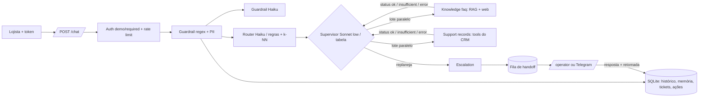

# Getnet Support Agents

Sistema multiagente de atendimento ao lojista Getnet: responde dúvidas de produto com RAG sobre o site
oficial, consulta os dados do próprio lojista com ferramentas, busca na web o que é geral (clima, câmbio) e
passa para um humano quando não tem base para responder.

| | |
|---|---|
| Rodar | `docker compose up -d --build` → `http://localhost:8000/docs` · console do operador em `/operator` |
| Testar | `python scripts/check.py --docker` (lint, testes, eval com gate, build, imagem sem extras, smoke do container) |
| CI | [GitHub Actions](../../actions/workflows/ci.yml) (o run do último commit está na aba Actions) |
| Vídeo | [walkthrough na página de Releases](../../releases/tag/video) (MP4 + legendas; narração por IA a partir do roteiro do autor, telas e números reais) |
| Docs | [Arquitetura](docs/ARCHITECTURE.md) · [Observabilidade](docs/OBSERVABILITY.md) · [Runbook](docs/RUNBOOK.md) · [SPEC](docs/SPEC.md) · [ADRs](docs/adr/) |

> **Para quem avalia lendo.** Toda afirmação deste README aponta um arquivo, um teste ou um resultado
> commitado em `evals/results/`. Os números da §5 são gerados por `scripts/fill_readme.py`, nunca digitados.

## 1. Como construir, configurar, rodar e testar

### 1.1 Docker (caminho do avaliador)

```bash
cp .env.example .env                      # opcional: sem chave roda no modo offline determinístico
docker compose up -d --build
curl -s localhost:8000/health
curl -s -X POST localhost:8000/chat -H "Content-Type: application/json" \
     -d '{"message":"What is the difference between the Get Clássica and the Get Smart?","user_id":"cliente1988"}'
```

O payload literal do enunciado (`{"message", "user_id"}`) funciona porque o compose do desafio liga
`AUTH_MODE=demo`; a resposta traz `identity_verified=false` para ninguém confundir demo com segurança
([ADR 0001](docs/adr/0001-auth-mode-demo.md)). Com identidade verificada:

```bash
TOKEN=$(docker compose exec -T api python -m app.auth cliente1988)   # JWT de desenvolvimento assinado
curl -s -X POST localhost:8000/chat -H "Authorization: Bearer $TOKEN" \
     -H "Content-Type: application/json" -d '{"message":"Quando cai o dinheiro das vendas de ontem?"}'
```

### 1.2 Local (sem Docker)

```bash
python -m venv .venv && .venv/bin/pip install -r requirements-dev.lock && .venv/bin/pip install -e .
.venv/bin/uvicorn app.api:app --app-dir src --reload          # Windows: .venv\Scripts\uvicorn.exe
```

### 1.3 Configuração (`.env`, todas opcionais)

| Variável | Padrão | Efeito |
|---|---|---|
| `LLM_PROVIDER` | `offline` | `anthropic` liga os modelos; `offline` usa só os caminhos determinísticos (CI) |
| `ANTHROPIC_API_KEY` | — | chave do provedor (nunca commitada; `.env` está no `.gitignore`) |
| `AUTH_MODE` | `required` no código, `demo` no compose | identidade só do Bearer × aceita `user_id` do corpo marcado como não verificado |
| `AUTH_SECRET`, `TOKEN_TTL_MIN`, `AUTH_ISSUER`, `AUTH_AUDIENCE` | segredo de dev, 60, `app`, `app-api` | JWT HS256 com `exp`/`iss`/`aud`/`jti` |
| `OPERATOR_KEYS` | — | `nome:chave,...`: chave pessoal por operador (a auditoria grava quem respondeu) |
| `RATE_LIMIT_PER_MIN` | 30 | por identidade (por IP no modo demo); falha fechado |
| `RETRIEVER` / `RERANK` | `bm25` / `auto` | `hybrid` = BM25 + embeddings (RRF); rerank do top-20 pelo Haiku quando há LLM |
| `COVERAGE_MIN_SCORE` | calibrado | limiar do portão "sem fonte, sem afirmação" (escolhido por `--calibrate-gate`) |
| `ROUTER_MODEL`, `SUPERVISOR_MODEL`, `AGENT_MODEL`, `*_EFFORT` | ver `src/app/config.py` | modelo e effort por papel |
| `ACTION_TTL_MIN`, `SLA_HIGH_MIN`, `SLA_NORMAL_MIN` | 15, 120, 480 | validade da ação pendente e SLA do caso humano |
| `TELEGRAM_*` | — | canal opcional do operador (aviso do caso + `/responder T-xxxx texto`) |
| `OTEL_EXPORTER` | — | `console` ou `otlp` liga OpenTelemetry (extra `.[otel]`) |

### 1.4 Testes

```bash
python scripts/check.py            # ruff + pytest + eval offline com gate
python scripts/check.py --docker   # + build, imagem sem extras de dev e smoke HTTP do container
python -m evals.run_evals --compare-retrievers --rerank       # Recall@3/MRR por retriever
powershell -File scripts/live_eval.ps1 -MaxUsd 3               # ao vivo por split, com teto de US$ (bash: scripts/live_eval.sh)
```

**Estratégia de testes** (detalhe em [docs/EVAL_STRATEGY.md](docs/EVAL_STRATEGY.md)), em quatro camadas:

| Camada | O que prova | Onde |
|---|---|---|
| Unidade | cada peça isolada: tokenização e BM25, regras do router, tabela do supervisor, tools, guardrails, JWT | `tests/test_*.py` |
| Integração da orquestração | o turno inteiro pelo `TestClient` com LLM falso que injeta falha: replanejamento, paralelismo, handoff, retomada | `tests/test_supervisor.py`, `tests/test_hitl.py`, `tests/test_parallel.py` |
| HTTP no container | os 10 cenários do enunciado × `AUTH_MODE` demo e required | `tests/test_domain_http.py`, smoke do `check.py --docker` |
| Qualidade de IA | golden set por split com gate no CI, held-out cego, ao vivo com pass^k, juiz LLM calibrado contra rótulos humanos | `evals/` |

## 2. Arquitetura



| Agente do enunciado | Nome no código | Fonte de verdade | Saída |
|---|---|---|---|
| Agent 1 — Router | `src/app/router.py` + supervisor (`src/app/supervisor.py`) | taxonomia da [SPEC](docs/SPEC.md) | intent, plano, idioma, confiança; replanejamento |
| Agent 2 — Knowledge | `faq` (`agents.faq_agent`) | corpus do site Getnet Brasil; busca web só para `general` | resposta com `sources` citadas, ou `insufficient` |
| Agent 3 — Customer Support | `records` (`agents.records_agent`) | CRM do lojista autenticado, 6 tools | dados, `tool_calls`, `pending_action` para escrita |
| Agent 4 (bônus) — Human Escalation | `escalation` | fila persistida de tickets | protocolo; a resposta humana volta à conversa |

Os nomes `faq`/`records` são o contrato do kit; trocá-los com 8 forks em paralelo custaria a integração
([ADR 0003](docs/adr/0003-kit-declarado.md)). Os agentes se comunicam por **chamada direta de função** com um
contrato único (`AgentResult` com `status: ok | insufficient | error`, em `src/app/agents.py`); com LLM, o
supervisor os enxerga como **tools** (`faq_agent`, `records_agent`, `escalation_agent`, JSON Schema `strict`).
O supervisor decide pelo status, nunca pelo texto, e todo desvio do plano vai para `replans` na resposta.

**Taxonomia (SPEC) e plano inicial de cada intent:**

| Intent | Quando | Plano | Se falhar |
|---|---|---|---|
| `knowledge` | como funciona produto, tarifa ou regra da Getnet | `faq` | sem fonte → humano |
| `support` | **dado** do próprio lojista (quando cai, quanto vendi, antecipar meu valor) | `records` | erro de tool → knowledge → humano |
| `troubleshoot` | **sintoma** operacional (não conecta, erro, recusa) | `records` + `faq` | humano |
| `general` | clima, câmbio, assunto fora da Getnet | `faq` com busca web | **não escala**: sem web, diz que não sabe |
| `multi` | duas perguntas de intents diferentes | união ordenada, em paralelo | conforme cada parte |
| `human_request` | pede atendente | `escalation` | — |
| `blocked` | guardrail barrou | — | recusa padrão |

Os três diagramas detalhados (agentes, RAG, HITL) estão em [docs/ARCHITECTURE.md](docs/ARCHITECTURE.md).

### 2.1 Fluxo de uma mensagem

| # | Etapa | Código | LLM? |
|---|---|---|---|
| 1 | Autenticação (JWT ou demo) e rate limit no SQLite | `src/app/auth.py` | não |
| 2 | Guardrail 1: regex de injeção (com desofuscação), PII mascarada antes de qualquer outra etapa | `src/app/guardrails.py` | não |
| 3 | Em paralelo: guardrail 2 (classificador Haiku) e router | `src/app/pipeline.py` | sim (Haiku) |
| 4 | Router: intenção, plano, idioma, confiança (JSON schema + few-shot dinâmico; regras + k-NN offline) | `src/app/router.py` | sim, com fallback |
| 5 | Supervisor: executa o plano, roda agentes independentes em paralelo, lê o status e replaneja dentro de `ALLOWED` e `MAX_STEPS` | `src/app/supervisor.py` | sim (Sonnet low), com fallback em tabela |
| 6 | Agentes: knowledge `faq` (RAG/web), support `records` (tools `get_settlements`, `get_transactions`, `get_terminal_status`; escrita `restart_terminal`, `request_anticipation`, `open_chargeback` só com confirmação), escalation (ticket) | `src/app/agents.py`, `src/app/tools.py` | sim (Sonnet medium), com caminho determinístico |
| 7 | Saída segura: máscara de PII e **checagem de todo número contra fonte, tool e pergunta** | `src/app/grounding.py` | não |
| 8 | Persistência: mensagens, resumo rolante, memória do lojista, analytics do request | `src/app/store.py` | não |
| 9 | Resposta JSON: `answer`, `intent`, `route`, `replans`, `sources`, `tool_calls`, `handoff`, `pending_action`, `unsupported_numbers`, `usage` (tokens e US$) | `src/app/schemas.py` | — |

### 2.2 RAG: ingestão → armazenamento → busca → geração

| Fase | O que acontece | Código / dado |
|---|---|---|
| Ingestão | páginas do site Getnet Brasil viram trechos literais de 300–800 caracteres, cortados em parágrafo, com título, URL, data de coleta e SHA-256; fontes listadas | `src/app/ingest.py`, [docs/SOURCES.md](docs/SOURCES.md), [docs/SOURCES_SUPORTE.md](docs/SOURCES_SUPORTE.md) |
| Armazenamento | JSONL versionado no git em `data/knowledge/`; documento com injeção é descartado na carga (`poisoned_docs_dropped_total`); índice em memória recarregado quando o arquivo muda | `src/app/rag.py::load_docs` |
| Busca | consulta expandida pelo glossário pt↔en → BM25 (k1 1,5, b 0,75, título com peso 2) ou híbrido (BM25 + embeddings por RRF k=60) → rerank do top-20 pelo Haiku | `src/app/rag.py`, `data/glossary.json` |
| Portão | sem trecho acima de `COVERAGE_MIN_SCORE` → `insufficient` → o supervisor replaneja (pergunta da Getnet sem fonte → humano; `general` usa a web e nunca escala) | `src/app/agents.py::covered_hits` |
| Geração | Sonnet responde só dos trechos numerados, cita `[n]` ou devolve `NOT_IN_SOURCES`; número da resposta conferido contra os trechos | `src/app/prompts/faq.md`, `src/app/grounding.py` |
| Medida | Recall@3 e MRR por retriever, com e sem rerank | `evals/retrieval.jsonl`, `evals/results/` |

### 2.3 Como usei LLM, e onde NÃO usei

| Papel | Modelo / effort | Por quê |
|---|---|---|
| router, guardrail 2, reranker | Haiku 5.5, low | classificação curta com schema; barato e rápido |
| supervisor | Sonnet 5.5, low | só escolhe o próximo especialista |
| agentes (knowledge, support, resume) | Sonnet 5.5, medium | redige com fonte e usa tools |
| juiz do eval | Opus 5.5, medium | pelo menos tão capaz quanto o julgado |

Recursos do provedor usados: tool use com `strict` (especialistas como tools do supervisor; tools do CRM),
JSON schema na saída do router, web search nativo para perguntas gerais, effort por papel. Nos modelos 5.5 não
existe `temperature`: a estabilidade vem de schema, enum e código determinístico.

**Onde NÃO usei LLM, de propósito:**
- autenticação, rate limit e identidade das tools (o `user_id` vem do token, nunca do modelo);
- guardrail 1 e máscara de PII (regex auditável roda antes de qualquer modelo ver o texto);
- **checagem de números** da resposta (`src/app/grounding.py`): determinística, roda em todo turno;
- cálculo de liquidação em dias úteis e feriados, e execução das ações (`src/app/tools.py`);
- portão de cobertura, transições permitidas (`ALLOWED`) e teto de passos (`MAX_STEPS`);
- memória de longo prazo e resumo rolante (auditáveis, sem custo, sem PII);
- o caminho offline inteiro: o CI roda sem chave e qualquer erro do provedor cai nele.

### 2.4 Servidor MCP

O mesmo sistema é exposto como servidor MCP em `/mcp` (`src/app/mcp_server.py`), para ser usado por outro
agente (Claude Desktop, Claude Code): `ask` (o turno inteiro), `search_knowledge` (busca com fonte) e
`crm_tool` (tools do CRM). Exige Bearer JWT antes do protocolo (401 anônimo); a identidade vem do token e a
escrita continua exigindo confirmação do dono (`tests/test_mcp.py`).

## 3. Cobertura da régua de avaliação

Mapa para quem avalia **lendo**: código, teste que prova e onde está o número. Os números vêm dos
blocos da §5, gerados de `evals/results/` por `scripts/fill_readme.py`. Todo caminho em crase desta
seção existe: `tests/test_evidence.py` falha se um sumir. Reproduzir tudo: `python scripts/check.py --docker`.

| Critério | O que foi feito | Código | Prova | Número |
|---|---|---|---|---|
| Business & Challenge Fit | os 10 cenários literais do enunciado no split `official`, via HTTP nos dois modos de auth; multi-turno | `src/app/tools.py` | `evals/cases.jsonl` | §5 Offline e Ao vivo, `official` |
| Orchestration | Supervisor LLM com agentes como tools, lê `insufficient`/`error` e replaneja; tabela PLANS/FALLBACK/ALLOWED/MAX_STEPS; agentes independentes em paralelo | `src/app/supervisor.py` | `tests/test_supervisor.py::test_llm_reads_insufficient_and_replans_to_escalation`, `tests/test_supervisor.py::test_llm_disallowed_transition_is_refused`, `tests/test_parallel.py::test_independent_agents_run_in_parallel_in_plan_order` | §5 Replanejamento, splits `replan` e `parallel` |
| Router | Haiku com JSON schema e few-shot dinâmico (8 exemplos mais parecidos); regra por frase + k-NN de n-gramas no offline; seguimento pela última fala com assunto; teste que reprova frase do held-out copiada para regra | `src/app/router.py` | `tests/test_router.py::test_llm_failure_falls_back_to_rules`, `tests/test_router_knn.py::test_unseen_paraphrase_goes_to_right_intent`, `tests/test_router_followup.py::test_follow_up_skips_acknowledgement`, `tests/test_router_contamination.py::test_detector_catches_v3_leak` | §5 Offline, `intent_acc` |
| Context, Knowledge & RAG | BM25 e híbrido (RRF) atrás de `RETRIEVER`, com **rerank do top-20 pelo Haiku** quando há LLM; "sem fonte, sem afirmação"; **todo número da resposta conferido contra fonte, tool e pergunta** (sem LLM; `unsupported_numbers` na resposta) | `src/app/rag.py`, `src/app/grounding.py` | `tests/test_rag.py::test_compare_retrievers_reports_both`, `tests/test_rerank.py::test_rerank_follows_the_llm_order_and_keeps_bm25_scores`, `tests/test_rerank_eval.py::test_compare_adds_a_rerank_row_only_when_asked`, `tests/test_agents.py::test_faq_llm_not_in_sources_is_insufficient`, `tests/test_grounding.py::test_pipeline_flags_invented_number_and_counts_it`, `evals/retrieval.jsonl` | §5 Offline, Recall@3, MRR e `numbers_acc` |
| Tool & Action | JSON Schema, identidade do servidor, escrita com confirmação do dono; **risco alto com aprovação de operador (quatro olhos)**; ação pendente expira (TTL); execução única entre réplicas; **servidor MCP em `/mcp`** (ask, search_knowledge, crm_tool; JWT obrigatório) | `src/app/actions.py`, `src/app/tools.py`, `src/app/mcp_server.py` | `tests/test_mcp.py::test_crm_tool_identity_comes_from_token_and_write_needs_confirmation`, `tests/test_mcp.py::test_anonymous_gets_401_before_the_protocol`, `tests/test_agents.py::test_tool_identity_is_server_side`, `tests/test_hitl.py::test_high_risk_action_needs_owner_then_operator_and_runs_once`, `tests/test_hitl.py::test_pending_action_expires`, `tests/test_memory_and_handoff.py::test_claim_is_atomic` | §5 Offline, `tools_acc` |
| Security & Identity | JWT HS256 com `exp`/`iss`/`aud`/`jti` e revogação; operador com chave pessoal (auditoria); rate limit no SQLite que falha fechado; `AUTH_MODE` required/demo; guardrails regex + Haiku com desofuscação e injeção indireta; PII mascarada na entrada, no log e na saída | `src/app/auth.py`, `src/app/guardrails.py` | `tests/test_identity.py::test_expired_token_is_rejected`, `tests/test_identity.py::test_revoked_token_is_rejected_via_api`, `tests/test_identity.py::test_rate_limit_fails_closed`, `tests/test_guardrails.py::test_obfuscated_injection_is_caught`, `tests/test_guardrails.py::test_poisoned_document_is_dropped_at_load`, `docs/adr/0001-auth-mode-demo.md` | §5 Offline, split `guardrail` |
| Memory, State & Resilience | Histórico em SQLite (WAL, vários processos) com **resumo rolante** além da janela; memória de longo prazo por usuário; queda do LLM cai no determinístico | `src/app/store.py`, `src/app/pipeline.py` | `tests/test_memory_and_handoff.py::test_history_survives_restart`, `tests/test_analytics.py::test_rolling_digest_keeps_early_facts_beyond_the_window`, `tests/test_identity.py::test_sqlite_survives_concurrent_writers`, `tests/test_agents.py::test_records_llm_failure_uses_deterministic_path` | §5 Offline, split `memory` |
| Human Oversight | Fila persistida e console; **a resposta do operador retoma a conversa na hora**; aprovação de ação de risco; SLA com re-escalonamento único; Telegram ida e volta | `src/app/resume.py`, `src/app/api.py`, `src/app/notify.py` | `tests/test_hitl.py::test_operator_reply_resumes_the_conversation_immediately`, `tests/test_hitl.py::test_overdue_case_is_escalated_once`, `tests/test_hitl.py::test_two_simultaneous_replies_only_one_wins`, `tests/test_notify.py::test_reply_from_telegram_resumes_conversation` | §5 Offline, `handoff_acc` |
| Evaluation & Quality | Gate offline no CI; ao vivo por split com teto de US$; `--repeat N` (pass^k, instáveis); juiz calibrado (kappa, TPR/TNR); checagem numérica sem LLM; matriz de falhas; limiar do portão por medida | `evals/run_evals.py`, `evals/judge.py`, `src/app/grounding.py` | `tests/test_evals.py::test_gate_passes_in_process`, `tests/test_evals.py::test_calibration_reports_tpr_tnr`, `tests/test_evals.py::test_repeat_reports_pass_hat_k_and_unstable_cases`, `tests/test_rag.py::test_gate_threshold_is_chosen_by_measurement`, `tests/test_eval_isolation.py::test_each_case_starts_without_memory_of_other_cases`, `tests/test_eval_judge_evidence.py::test_live_rows_record_tool_calls_sources_and_evidence`, `tests/test_eval_language_ci.py::test_detects_language_of_the_text`, `evals/judge_calibration.jsonl` | §5 Offline, Ao vivo e Juiz |
| Observability, Reliability & Cost | Log JSON com `trace_id` e status de cada agente; US$ e tokens por request; `/metrics`; **alertas Prometheus provisionados**; `/analytics` (resolução, custo por resolvido, 👍/👎); OTel por env; SLOs e painéis em `docs/OBSERVABILITY.md` | `src/app/observability.py`, `src/app/analytics.py`, `ops/alerts.yml` | `tests/test_agents.py::test_cost_per_request_from_price_table`, `tests/test_alerts.py::test_alert_rules_are_valid_and_actionable`, `tests/test_analytics.py::test_every_request_is_logged_and_feedback_is_owned`, `tests/test_otel.py::test_console_exporter_emits_span_linked_to_trace_id` | §5 Ao vivo, `cost_usd` e p95 |
| Production Engineering | Dockerfile multi-stage não-root, base fixada por digest com Dependabot, extra opcional embutido (`EXTRAS=hybrid`), lockfiles, smoke do container no CI; scripts em bash e PowerShell; runbook | `Dockerfile` | `scripts/check.py`, `.github/workflows/ci.yml`, `.github/dependabot.yml`, `requirements.lock`, `requirements-hybrid.lock`, `scripts/live_eval.sh`, `docs/RUNBOOK.md` | link do CI no topo |
| Engineering Judgment | Decisões com a alternativa descartada e o número que a descartou; limitações com próximo passo; ADRs | `docs/adr/0001-auth-mode-demo.md` | §4 e §9 deste README | — |

## 4. Decisões e trade-offs

| Decisão | Alternativa descartada | O que descartou |
|---|---|---|
| Supervisor LLM com tabela determinística como fallback | só LLM / só tabela | só LLM deixa o CI dependente de chave; só tabela não replaneja casos novos. Ver §5 Replanejamento, offline × ao vivo |
| Agentes independentes em threads | asyncio | os agentes fazem I/O síncrono (SQLite, SDK); threads cortam o p95 sem reescrever a pilha (`tests/test_parallel.py`) |
| Effort por papel (supervisor low, agentes medium) | um effort global | o p95 ao vivo da v2 vinha do supervisor em medium (comentário em `src/app/config.py`) |
| BM25 + rerank Haiku do top-20 | embeddings desde o início | medido antes do relógio: o BM25 já acha a fonte no top-20 em 90,4% e no top-3 em 70,8%; o gargalo é a ordem, não o recall (`src/app/config.py`). Números deste corpus: `--compare-retrievers --rerank` em `evals/results/` |
| Glossário pt↔en na consulta | traduzir a pergunta com LLM | custo e latência em todo turno para um mapeamento fixo de termos de produto |
| Portão de cobertura com limiar calibrado | limiar escolhido à mão | `--calibrate-gate` escolhe o limiar que maximiza respondidas com recusa ≥ 85% (`tests/test_rag.py::test_gate_threshold_is_chosen_by_measurement`) |
| Checagem de números sem LLM | juiz LLM em todo turno | determinística, grátis, roda em 100% dos turnos; o juiz fica no eval |
| SQLite atrás de `Store` | Postgres/Redis | sobe com um comando; a troca para réplicas fica isolada num módulo ([ADR 0002](docs/adr/)) |

## 5. Avaliação

Números gerados por `python scripts/fill_readme.py` a partir de `evals/results/`.

### Offline (gate do CI)

<!-- eval:begin -->
<!-- eval:end -->

### Ao vivo (LLM real, por split)

<!-- eval-live:begin -->
<!-- eval-live:end -->

### Juiz LLM sobre as respostas ao vivo

<!-- judge:begin -->
<!-- judge:end -->

### Replanejamento

<!-- replan:begin -->
<!-- replan:end -->

## 6. Spec e rastreabilidade

Spec em [docs/SPEC.md](docs/SPEC.md), commitada antes do código. ADRs em [docs/adr/](docs/adr/).

## 7. Linha do tempo (git log)

<!-- timeline:begin -->
<!-- timeline:end -->

## 8. Scaffold declarado (kit) e o que foi feito no relógio

A infraestrutura genérica vem de um kit próprio, preparado antes do desafio e declarado no primeiro
commit (`chore: scaffold`):
- FastAPI, Docker, CI e lockfiles;
- runner de eval (offline, ao vivo por split com teto de US$, `--repeat` com pass^k, calibração do
  portão), checagem numérica e juiz calibrado (kappa, TPR/TNR);
- identidade JWT com expiração e revogação, operador com chave pessoal, rate limit compartilhado;
- memória com resumo rolante, fila humana com retomada imediata, aprovação de quatro olhos, SLA;
- supervisor que replaneja com agentes em paralelo, busca BM25/híbrida, guardrails com desofuscação;
- logs, métricas, alertas provisionados, custo, analytics e OpenTelemetry opcional.

**Por que um kit.** É a prática de engenharia de implantação (forward deployed): bibliotecas comuns e
automação do trabalho repetível, para o tempo do cliente ir para o problema dele (a16z, "Trading Margin
for Moat", 04/06/2025: "Build common software libraries" e "Build/buy tools to automate"). O que é
específico do desafio (spec, base de conhecimento, ferramentas do domínio, casos de avaliação, prompts,
regras do router e do supervisor) foi escrito no relógio. A medida, tirada do git:

<!-- kit:begin -->
<!-- kit:end -->

## 9. Limitações e próximos passos

| Limitação | Próximo passo |
|---|---|
| CRM fictício (lojistas `cliente1988` e `cliente2024`, datas relativas a hoje) | trocar `src/app/tools.py` por cliente HTTP da API real; o contrato das tools não muda |
| Rate limit, métricas e cache no processo/SQLite de um nó | Redis para limite e locks, Prometheus remoto, Postgres atrás de `Store` ([ADR 0002](docs/adr/)) |
| Corpus é um retrato do site na data de coleta | reingestão agendada com diff por SHA-256 e alerta de página que sumiu |
| Held-out e rótulos humanos com um único autor | segundo rotulador e kappa entre humanos |
| Eval ao vivo cobre parte dos casos por custo | rodar o conjunto inteiro com `--repeat 3` no CI noturno com teto de US$ |
