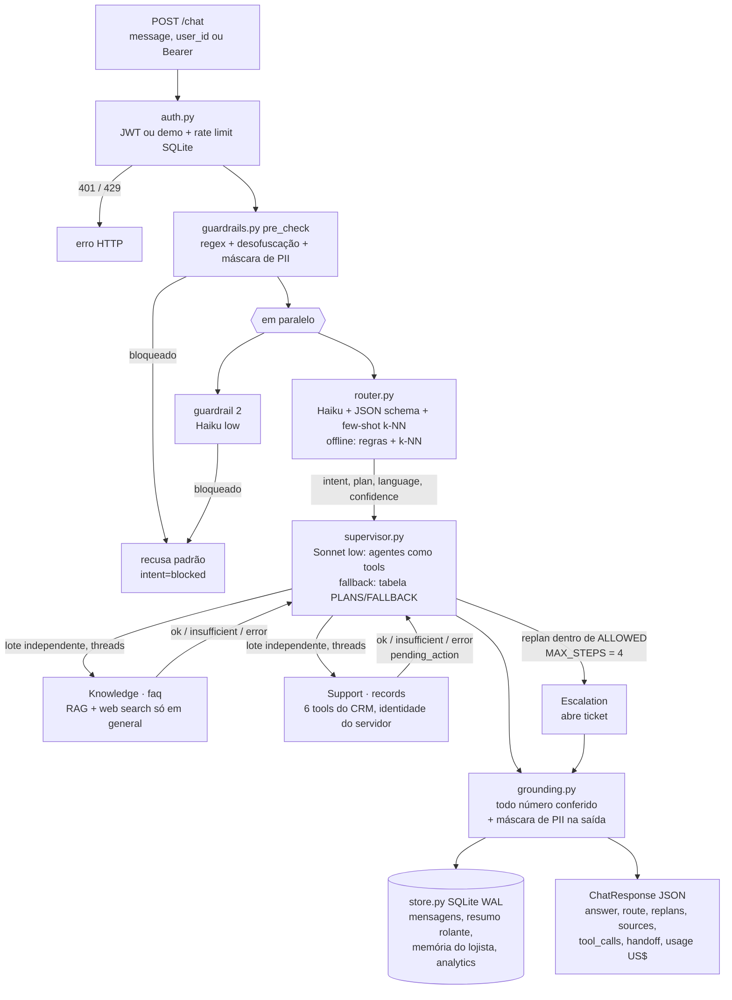
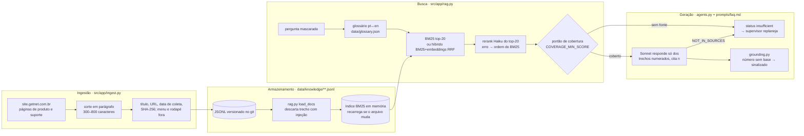

# Arquitetura

Três vistas do mesmo sistema: como os agentes cooperam num turno, como o RAG transforma o site em resposta
citada, e como um caso sai para o humano e volta para o lojista. Cada caixa aponta o arquivo que a implementa.

## 1. Fluxo de agentes (um turno de `POST /chat`)



Regras que o desenho garante:
- **Nomes.** No código os agentes são `faq` (Knowledge Agent do enunciado), `records` (Customer Support Agent) e `escalation`; mapa e motivo na [SPEC](SPEC.md) e no [ADR 0003](adr/0003-kit-declarado.md).
- **Uma fonte de verdade por agente.** Knowledge só afirma o que está no corpus ou na web, com citação; support
  só lê o CRM do lojista autenticado; escalation só abre caso. Nenhum agente inventa o papel do outro.
- **Contrato único.** Todo agente devolve `AgentResult` (`src/app/agents.py`) com `status`, `text`, `sources`,
  `evidence`, `tool_calls`, `handoff`, `pending_action`. O supervisor decide pelo `status`, não pelo texto.
- **Determinismo de saída.** Agentes paralelos entram na resposta na ordem do plano, nunca na de término;
  todo desvio do plano vai para `replans`.
- **Queda do provedor não derruba o atendimento.** Qualquer `LLMError` no router, no supervisor ou nos agentes
  cai no caminho determinístico equivalente (`engine` na resposta diz qual rodou).

## 2. RAG: ingestão → armazenamento → busca → geração



Medida: `evals/retrieval.jsonl` (perguntas com a fonte esperada) → `python -m evals.run_evals
--compare-retrievers --rerank` grava Recall@3 e MRR por retriever em `evals/results/`.

## 3. HITL: handoff → operador → retomada

```mermaid
sequenceDiagram
  autonumber
  participant L as Lojista
  participant API as /chat (pipeline)
  participant SUP as Supervisor
  participant E as escalation_agent
  participant DB as SQLite (tickets, actions)
  participant OP as Operador (/operator ou Telegram)
  participant RS as resume.py

  L->>API: mensagem sem base / pedido de humano / ação de risco
  API->>SUP: plano do router
  SUP->>E: replan (insufficient, error, baixa confiança ou pedido explícito)
  E->>DB: open_ticket (idempotente por conversa, leva a memória do lojista)
  E-->>OP: aviso opcional no Telegram (a fila é a fonte da verdade)
  API-->>L: "Encaminhei (protocolo T-xxxx); a resposta aparece nesta conversa"
  OP->>DB: GET /handoffs (histórico do caso)
  OP->>API: POST /handoffs/{id}/reply (X-Operator-Token pessoal)
  API->>DB: answer_ticket: claim atômico, só uma resposta vence
  API->>RS: resume_after_human(ticket, operador)
  RS->>RS: Sonnet redige a próxima fala a partir da resposta humana<br/>(sem LLM: resposta literal identificada)
  RS->>DB: mensagem "resumed" na conversa, PII mascarada, números conferidos
  L->>API: GET /conversations/{id} ou próximo turno: já vê a resposta
  Note over DB,OP: SLA: POST /handoffs/sla-check re-escalona uma única vez o caso vencido
  Note over L,OP: Ação de risco alto: dono confirma (POST /actions/{id}/confirm) → operador aprova<br/>(/approve) → executa uma vez; ação pendente expira em ACTION_TTL_MIN
```

## Componentes

| Módulo | Responsabilidade |
|---|---|
| `src/app/api.py` | rotas HTTP, operador, Telegram, `/health`, `/metrics` |
| `src/app/pipeline.py` | orquestração de um turno (ordem acima) |
| `src/app/router.py` | intenção, plano, idioma, confiança; seguimento de conversa |
| `src/app/supervisor.py` | motores LLM e tabela, `PLANS`, `FALLBACK`, `ALLOWED`, `MAX_STEPS`, paralelismo |
| `src/app/agents.py` | knowledge, support, escalation; portão de cobertura; glossário |
| `src/app/tools.py`, `src/app/actions.py` | tools do CRM com JSON Schema; ações com confirmação, TTL e quatro olhos |
| `src/app/rag.py`, `src/app/ingest.py` | ingestão, índice, BM25/híbrido/rerank, Recall@K e MRR |
| `src/app/guardrails.py`, `src/app/grounding.py` | entrada e saída seguras; checagem numérica |
| `src/app/store.py` | SQLite WAL: conversas, memória, tickets, ações, rate limit, analytics |
| `src/app/resume.py`, `src/app/notify.py` | retomada depois do humano; Telegram |
| `src/app/observability.py`, `src/app/analytics.py` | log JSON com `trace_id`, métricas, custo, OTel |
| `src/app/mcp_server.py` | o sistema como servidor MCP em `/mcp` |
